<picture>
  <source media="(prefers-color-scheme: dark)" srcset="assets/intro-dark.svg" />
  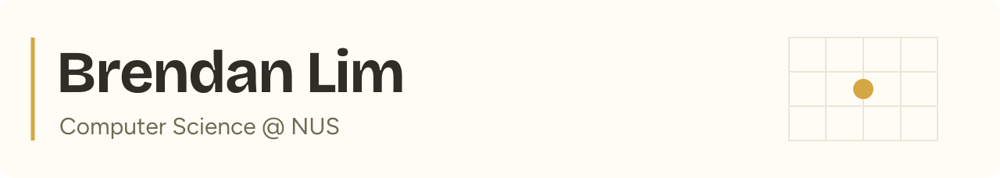
</picture>

Hi, I'm Brendan, a Computer Science undergraduate and NUS Merit Scholar. I build AI products and developer tools for problems I've run into myself, and I like shipping them to real users.

📫 [limkaihuibrendan@u.nus.edu](mailto:limkaihuibrendan@u.nus.edu) · [LinkedIn](https://www.linkedin.com/in/brendanlimkh/)

### What I'm working on

- 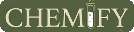 **Chemify** · *Founding software engineer.* Building a tuition operations platform with an AI agent for enquiries and trial sign-ups.
-  **Project Battambang, NUS Medicine** · *Software developer.* Building an offline-first fieldwork app for rural Cambodia.
-  **NUS Computing Developer Group** · *Technology associate.* Building a volunteer management system for ACRES.
- <picture><source media="(prefers-color-scheme: dark)" srcset="assets/logos/upcycler-dark.png" /></picture> **Upcycler Studios** · *Previously SWE & operations intern.* Implemented data pipelines for better sourcing decisions.

### 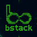 Building [bstack](https://github.com/bstack-tools)

Tools that make coding agents easier to work with.

-  **[ContextLens](https://github.com/bstack-tools/ContextLens)** · A native Mac app. Capture a window, mark what should change, and hand the screenshots and instructions to Claude Code or Codex.
  `brew install --cask Brendan-Lim/tap/contextlens-preview`
- 🔁 **[ALL · Agent Learning Loop](https://github.com/bstack-tools/all-agent-learning-loop)** · Turns coding-agent corrections into reviewed project safeguards. *In development.*

### Projects

<a href="https://github.com/Brendan-Lim/Quack#gh-light-mode-only">
  <picture>
    <source media="(max-width: 600px)" srcset="assets/quack-mobile.svg" />
    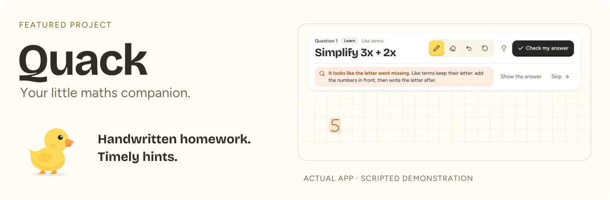
  </picture>
</a>
<a href="https://github.com/Brendan-Lim/Quack#gh-dark-mode-only">
  <picture>
    <source media="(max-width: 600px)" srcset="assets/quack-mobile-dark.svg" />
    
  </picture>
</a>

-  **[Quack](https://github.com/Brendan-Lim/Quack)** · An AI maths tutor for handwritten homework. Meta's multimodal model reads the ink, SymPy checks the maths, and hints help students fix their own mistakes. Built for the Meta Global AI Developer Hackathon 2026. [Try Quack →](https://quack-amber-seven.vercel.app/)
-  **ExchangeCopilot** · Helps NUS students find overseas module equivalents for exchange. Uses hybrid search (PostgreSQL full-text, GTE embeddings, BGE reranker) to match courses. [Try ExchangeCopilot →](https://brendan-lim--mvp2-starter.us-east.modal.run/) (may take ~30 s to wake) · Source available on request.
-  **[PARALLAX](https://github.com/Brendan-Lim/PARALLAX)** · An evidence-aware astronaut health companion, built for the NASA Space Apps Challenge 2026. [Try PARALLAX →](https://parallax-health.brendanlimkh04.workers.dev/)
- 🐟 **[NotFreshEnough](https://github.com/Brendan-Lim/NotFreshEnough)** · An AI roaster for GitHub repos. 🏆 *Most Likely to Go Viral* at the TinyFish Hackathon 2026, out of 140+ submissions.
- 🎓 **[NUS Canvas → Telegram](https://github.com/Brendan-Lim/NUS-Canvas-Daily-Telegram-Reminder-Bot)** · Daily Canvas deadline digests on Telegram for NUS students, running serverless on GitHub Actions. Use the template to set up your own.

  <picture><source media="(prefers-color-scheme: dark)" srcset="assets/stack/python-dark.svg" />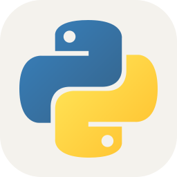</picture>
  
  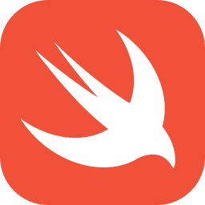
  <picture><source media="(prefers-color-scheme: dark)" srcset="assets/stack/java-dark.svg" />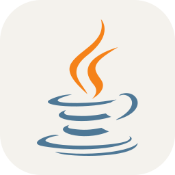</picture>
  <picture><source media="(prefers-color-scheme: dark)" srcset="assets/stack/nextjs-dark.svg" />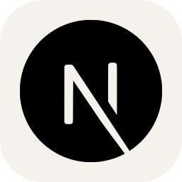</picture>
  <picture><source media="(prefers-color-scheme: dark)" srcset="assets/stack/react-dark.svg" />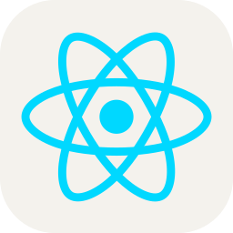</picture>
  <picture><source media="(prefers-color-scheme: dark)" srcset="assets/stack/tailwindcss-dark.svg" />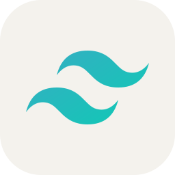</picture>
  
  <picture><source media="(prefers-color-scheme: dark)" srcset="assets/stack/nodejs-dark.svg" />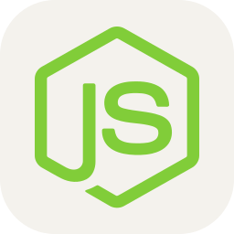</picture>
  <picture><source media="(prefers-color-scheme: dark)" srcset="assets/stack/postgresql-dark.svg" />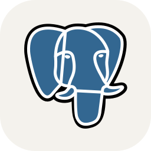</picture>
  <picture><source media="(prefers-color-scheme: dark)" srcset="assets/stack/supabase-dark.svg" />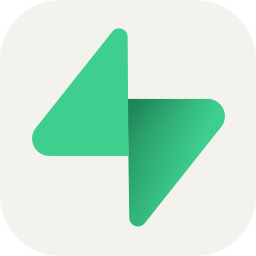</picture>
  
  <picture><source media="(prefers-color-scheme: dark)" srcset="assets/stack/gcp-dark.svg" />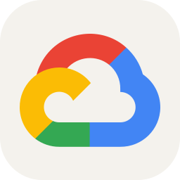</picture>
  <picture><source media="(prefers-color-scheme: dark)" srcset="assets/stack/cloudflare-dark.svg" />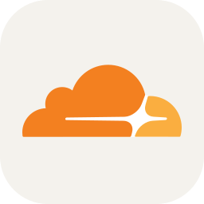</picture>

