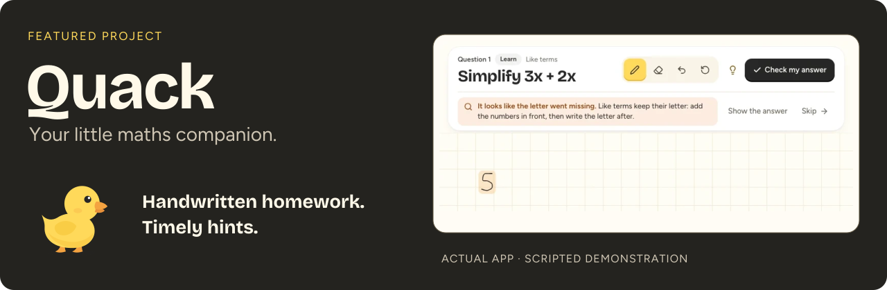

<picture>
  <source media="(prefers-color-scheme: dark)" srcset="assets/intro-dark.svg" />
  
</picture>

I'm Brendan, a Computer Science undergraduate at the **National University of Singapore**. I build AI-powered products around problems I've encountered firsthand, working across full-stack engineering, AI integration and product development.

### Featured project · Quack

<a href="https://github.com/Brendan-Lim/Quack#gh-light-mode-only">
  <picture>
    <source media="(max-width: 600px)" srcset="assets/quack-mobile.svg" />
    
  </picture>
</a>
<a href="https://github.com/Brendan-Lim/Quack#gh-dark-mode-only">
  <picture>
    <source media="(max-width: 600px)" srcset="assets/quack-mobile-dark.svg" />
    
  </picture>
</a>

Tutoring showed me how easily an unnoticed mistake can derail homework. **Quack** reads handwritten maths, checks supported steps with a symbolic verifier and offers hints so students can make their own corrections.

Next.js · TypeScript · Python / FastAPI · Meta Muse Spark · SymPy · Supabase

**[Try the app](https://quack-amber-seven.vercel.app/)** · **[Explore the source](https://github.com/Brendan-Lim/Quack)**

Actual interface, synthetic ink and scripted recognition. [Screenshot context](https://github.com/Brendan-Lim/Quack/blob/main/docs/media/README.md).

### Other work

- **[NotFreshEnough](https://github.com/Brendan-Lim/NotFreshEnough)** — A team-built AI repository roaster with an opinionated report-card experience. React, TypeScript, Express and TinyFish.
- **[NUS Canvas → Telegram](https://github.com/Brendan-Lim/NUS-Canvas-Daily-Telegram-Reminder-Bot)** — Personal deadline reminders, delivered through Telegram using Python and GitHub Actions.
